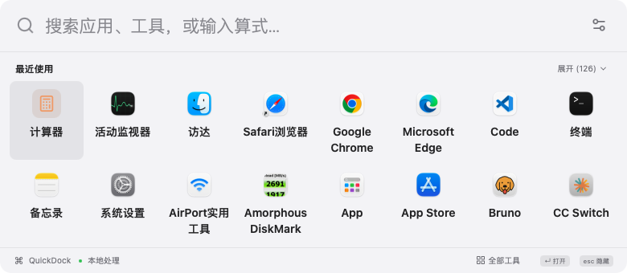

# QuickDock

基于 **Wails 3.1.0 + React + TypeScript** 的跨平台本地快捷工具。默认是紧凑启动面板，设置进入完整页面，工具独占工作区。

支持简体中文、日本語、English、繁體中文、Español，默认跟随系统；可在偏好设置切换，保留工具输入。

当前开发分支在 `online` 之上新增开机自启动、剪贴板历史、搜索关键词、文件搜索、结果次级操作、配置导入导出，以及正则、JWT、颜色、进制、文本对比、Cron 六个开发工具。这些更新尚未发布为新版本；公开稳定版仍为 v0.1.4。

## 本地运行

支持 macOS / Windows / Linux 的 arm64 与 x64，安装包由 GitHub Actions 自动编译并发布到 [Releases](https://github.com/yukunwu/QuickDock/releases)。本地打包输出位于 `bin/releases/`。Linux 同时提供 Debian 系 `.deb` 和 Fedora／Red Hat 系 `.rpm`。系统依赖、安装方式及实测范围见 [跨平台验证](docs/CROSS-PLATFORM-VALIDATION.md)。

macOS 将 `QuickDock.app` 拖入“应用程序”后打开，最低 macOS 13。本机安装路径为 `/Applications/QuickDock.app`：

```sh
open /Applications/QuickDock.app
```

- macOS `Option+Space`；Windows／Linux `Ctrl+Alt+Space`：显示／隐藏；设置中选择修饰键，Space 固定。
- Wayland 若无全局快捷键 Portal，在系统键盘设置中把快捷键命令设为 `quickdock --toggle`；重复执行切换原窗口。
- macOS／Windows／Linux X11 唤起跟随鼠标所在屏幕；Wayland 由桌面系统安排窗口位置。
- 空搜索展示最近使用的应用／工具，方向键选择，Enter 执行；支持中文、全拼、拼音首字母、英文名及英文缩写；例如微信可输入 `weixin`／`wx`／`wechat`，系统设置可输入 `xtsz`／`systemsettings`。支持空格、大小写与全角输入；网址仍支持别名。
- 输入无应用匹配时，提供 Google 搜索与翻译快捷项；搜索使用默认浏览器，翻译保留在当前 Dock。设置可分别关闭这两个入口。
- 搜索关键词：常用网址的 URL 含 `{query}`（或粘贴浏览器式 `%s`）即成为关键词，例如别名 `gh` + `https://github.com/search?q={query}`，在 Dock 输入 `gh rust` 直接搜索；只输入 `gh` 时 Enter／Tab 补全为 `gh `。设置中提供 GitHub、百度、Bing、Wikipedia 等常用搜索预设。
- 文件搜索：输入 `f 名称`（或 `find`／`文件`）搜索主目录中的文件，Enter 用默认应用打开。macOS 使用 Spotlight，Windows 使用 Windows Search 索引，Linux 使用 plocate／locate；隐藏目录、`node_modules` 和 `~/Library` 等缓存不显示。若 `f` 已是某个网址关键词，则关键词优先。
- 次级操作：`⌘↵`（Windows／Linux 为 `Ctrl+↵`）在访达／资源管理器中显示应用或文件，对网址则复制链接；底部提示当前所选项的操作。
- 顶部设置按钮或 `⌘ ,` 进入设置；底部“全部工具”进入工具库。
- 工具页占满窗口，不展示应用侧边栏和导航。Esc 回紧凑 Dock，Dock 再按 Esc 隐藏；独立工具 Esc 保存后关闭。`⌘ W` 隐藏；重新唤起清空搜索并回到紧凑 Dock，工具草稿仍在本次会话保留。
- 启动器失焦隐藏；工具和设置失焦保留。菜单栏闪电图标 可打开、刷新索引或退出。
- 每 3 秒轻量检查应用安装目录，新增、移除或更新入口后自动刷新索引；唤起时立即检查，5 分钟兜底同步，手动刷新仍可用。
- 重复启动只唤起原实例。
- 设置中可开启开机自动启动：macOS 通过 `SMAppService` 登记（需在“系统设置 › 登录项”允许时会提示并给出入口，应用须位于“应用程序”文件夹），Windows 写入当前用户 `Run` 项，Linux 写入 `~/.config/autostart/quickdock.desktop`。开机启动时保持隐藏，不弹出窗口。

macOS `.app` 使用 ad-hoc 签名，不含 Developer ID 签名或公证。内置自动更新检查与手动下载安装，发布包校验 SHA256；详情见 [自动更新](docs/UPDATES.md)。无需前端开发服务器即可运行。



## 二十类内置工具

| 工具 | 已实现功能 |
| --- | --- |
| 二维码生成器 | 本机生成文字／网址二维码，尺寸与容错级别选择；PNG／SVG导出、SVG复制，独立窗口恢复输入 |
| 翻译 | 原生内嵌Google翻译网页；工具页打开自动聚焦原文，加载转圈提示；Dock可选目标语言并重新提交；原文与语言恢复；自动记录原文与译文（连续输入合并为一条，最近200条），历史侧栏可载入、单条删除、清空 |
| 汇率换算 | 欧洲央行每日参考汇率（Frankfurter），金额支持算式、币种交换、常用货币对照与复制；仅下载汇率表，6小时缓存，离线显示上次汇率 |
| 计算稿纸 | 多行四则／括号／百分比，#备注，ans引用上一结果；逐行错误；停顿后自动记录历史（同一张稿纸持续更新一条，新稿纸另起一条），Dock 回车复制的算式也会记录；可载入、单条删除、清空；保留搜索内快速计算 |
| 时间与时区 | 自动识别秒／毫秒时间戳、日期或ISO；按任意时区解析日期；常用格式一键复制；世界时钟可增删城市（保存在本机），标注前后一日；空输入实时走秒；夏令时跳跃校验 |
| JSON | 格式化／压缩／错误提示；保留大整数精度 |
| Base64 | 标准 Base64 与 UTF-8 文本双向转换；非法字符、填充位、非 UTF-8 内容校验 |
| URL | URL **组件**编码／解码，`+` 不作为空格处理 |
| UUID | v4 随机／v7 时间有序，1–1000 个；大写、连字符、每行／JSON／逗号／SQL 格式；单行点击复制，⌘Enter 重新生成 |
| 文本哈希 | MD5、SHA1、SHA256、SHA512 |
| 单位换算 | 长度、质量、温度、面积、体积、速度、容量；十进制／二进制分别标明 |
| 文本处理 | 大小写、逐行 trim、删空行、去重、自然排序、Unicode 字符／行／UTF-8 字节统计 |
| 常用网址 | 名称、URL、别名增删改；搜索和默认浏览器打开；仅 HTTP(S)；URL 含 `{query}` 时成为搜索关键词，提供常用搜索预设 |
| 剪贴板历史 | 默认关闭，开启后记录复制的文本（最多200条，单条≤100KB），搜索、固定（最多50条）、单条删除、清空未固定项；Enter 写回剪贴板并隐藏 Dock 以便粘贴；跳过密码管理器标记为隐藏的内容 |
| 正则测试 | JavaScript 正则，匹配高亮、编号与命名分组、`$1`／`$<name>` 替换预览；在后台 Worker 中匹配，3 秒超时防止灾难性回溯卡死 |
| JWT 解码 | 头部／载荷格式化（保留大整数）、算法、iat／nbf／exp 时间与过期状态；只解码不验签，支持 Bearer 前缀，拒绝 JWE |
| 颜色转换 | 任意 CSS 颜色（HEX、rgb()、hsl()、oklch()、颜色名），输出 HEX／RGB／HSL／OKLCH，取色器，白底／黑底 WCAG 对比度与等级 |
| 进制转换 | 任意大小整数（BigInt），自动识别 0x／0o／0b，二、八、十、十六、三十六进制互转，分组显示、复制无空格 |
| 文本对比 | Myers 逐行差异，双侧行号，可忽略空白差异，交换左右；最多20000行／2000处差异 |
| Cron 表达式 | 5 段标准语法（名称、列表、范围、步长、@daily 等宏），字段解析，按本地或 UTC 预览接下来 10 次运行；日期与星期同时限定时按 Vixie 规则“满足其一” |

没有外部插件 SDK、商店或 uTools 兼容层。新增内置工具通过 `frontend/src/catalog.ts` 的 `ToolDefinition` 注册，纯转换逻辑在 `frontend/src/tools/` 中。

## 数据与原生能力

Windows 读取开始菜单／桌面快捷方式和已注册应用，ShellExecute 启动；Linux 读取 XDG／Flatpak／Snap `.desktop` 入口，通过 GIO 启动和 xdg-open 打开网址。Windows 数据位于 `%APPDATA%/QuickDock`；Linux 位于 `$XDG_CONFIG_HOME/QuickDock`（默认 `~/.config/QuickDock`）。以下路径说明为 macOS：

- 扫描 `/Applications`、`~/Applications`、`/System/Applications`，额外索引 Finder；不递归进入 `.app` 的内部 helper。
- 通过 AppKit 读取真实名称、图标和 Bundle ID，通过 NSWorkspace 启动应用、打开网址。
- 冷启动后台建立索引；已有缓存时先展示缓存，再刷新。目录扫描在后台，AppKit 操作切回主线程。
- 配置和使用记录：`~/Library/Application Support/QuickDock/settings.json`。
- 应用缓存：同目录 `apps.json`。JSON 带版本，原子写入；损坏配置保留 `.corrupt-时间戳` 备份并恢复默认，未知未来版本禁止覆盖。
- Dock内普通工具未保存的输入仅保留本次会话；独立窗口输入自动保存到`tool-windows/`；内部内存回收通过当前 WebView 会话历史临时传递草稿。
- 剪贴板历史写入同目录 `clipboard.json`（仅在开启后），版本化原子 JSON，最多200条、约4MiB；macOS／Windows 轮询系统剪贴板变更计数，只在复制后读取，开启前已在剪贴板的内容不记录；Linux 每1.5秒比较文本，Wayland 下可能只在 QuickDock 获得焦点时可读。
- 配置导入导出：设置页“备份与迁移”导出语言、外观、快捷键、工具开关、常用网址和世界时钟；使用记录与各类历史不导出。导入前确认，快捷键在本机不可用时保留当前快捷键。
- 明确保存的计算历史写入同目录 `calculations.json`，版本化原子JSON，最多100份／约8MiB。单稿纸最多200行／20000字符，重启后保留；浏览器预览历史独立保存在localStorage。
- 翻译通过原生WebView直接展示Google翻译网页，网页内输入交给Google处理；不再调用公共翻译API。独立页保存当前原文／语言，Google网页可能要求网站验证。详见[网页翻译验证](docs/GOOGLE-WEB-VALIDATION.md)。
- 浏览器预览明确使用示例应用，不能启动本机应用。原生版本通过 Wails 生成的类型绑定调用 Go。

## 构建与测试

三平台交付在 macOS 执行 `./scripts/build-platforms.sh`，再运行 `go install github.com/goreleaser/nfpm/v2/cmd/nfpm@v2.45.2` 和 `python3 scripts/package-platforms.py`。首次先运行 `./scripts/build-macos.sh` 生成应用图标。Linux 主机构建会生成 Windows／Linux 产物，Linux 包使用 GTK3 + WebKitGTK 4.1。

macOS 构建需要 Xcode Command Line Tools；项目需要 Go 1.26+、Node 22+ 和 pnpm。当前验证机器为 Go 1.27.1、Node 26.10.0、pnpm 10.32.0。

```sh
go install github.com/wailsapp/wails/v3/cmd/wails3@v3.1.0
pnpm --dir frontend install --frozen-lockfile
./scripts/build-macos.sh
```

构建脚本生成 bindings、编译前端／Go、制作图标和 `.app`，并做 ad-hoc 签名与校验。CLI 和 Go 依赖固定为相同 Wails 版本。`Taskfile.yml` 也可通过 `wails3 task build` 使用。

```sh
pnpm --dir frontend dev                 # 浏览器预览，127.0.0.1:3415
pnpm --dir frontend test                # 57 项逻辑测试
pnpm --dir frontend test:e2e            # Chrome 交互及搜索性能
MACOSX_DEPLOYMENT_TARGET=13.0 \
CGO_CFLAGS='-mmacosx-version-min=13.0' \
CGO_LDFLAGS='-mmacosx-version-min=13.0 -Wl,-no_warn_duplicate_libraries' \
go test -race ./...
```

Playwright 使用本机 `/Applications/Google Chrome.app`，可按实际安装位置修改 `frontend/playwright.config.ts`。开发端口默认 3415，已有服务时复用。

解锁桌面后，可用以下原生 smoke 脚本验证鼠标所在屏幕、相同快捷键隐藏及单实例。它会短暂移动鼠标并切换 QuickDock 的可见性，结束恢复鼠标位置；脚本针对默认 Option+Space，锁屏时跳过。

```sh
swift scripts/native-smoke.swift <QuickDock进程PID> "$PWD/bin/QuickDock.app/Contents/MacOS/QuickDock"
```

大文本计算使用可终止后台任务；结果预览最多 65,536 字符，复制保留全文。隐藏释放工具结果，用过大文本后连续隐藏 30 秒回收页面，唤起时恢复输入并重新计算。测量与回收边界见 [资源验证](docs/RESOURCE-VALIDATION.md)。

具体通过项、测量口径和未完成的人工验收见 [验证记录](docs/VALIDATION.md)。


Dock翻译及计算历史的新增验收、截图和网络边界见 [新增功能验证](docs/ONLINE-NOTEBOOK-VALIDATION.md)。开机启动、剪贴板历史、文件搜索与六个开发工具的验证见 [启动器增强验证](docs/LAUNCHER-ESSENTIALS-VALIDATION.md)。

### 独立工具窗口

搜索“翻译”或在工具库打开翻译，可在Google网页内直接输入文字翻译。工具页／Dock翻译的“独立窗口”携带当前内容弹出；工具库的“独立打开”恢复上次独立保存的页面，菜单栏也可直接打开翻译窗口。独立窗口不随Dock隐藏，输入与选项自动保存，关闭前等待保存。正常退出后重启恢复尚未关闭的窗口；显式关闭后可从工具库再打开，内容仍保留。

独立窗口草稿与几何信息位于 `~/Library/Application Support/QuickDock/tool-windows/`，单工具最多8MiB，底部显示保存状态。Dock内临时输入仍是会话状态。具体原生验证与测试方式见 [独立窗口验证](docs/DETACHED-WINDOWS-VALIDATION.md)。

## GitHub 与自动更新

仓库：[yukunwu/QuickDock](https://github.com/yukunwu/QuickDock)。下载见 [Releases](https://github.com/yukunwu/QuickDock/releases)。分支推送自动测试／编译；推送与 `VERSION` 一致的 `v*` 标签，全部测试通过后自动发布十份包与校验和。

设置页新增“应用更新”，启动后及每 6 小时自动检查稳定版；点击下载校验，再保存并重启。macOS／Windows 原生替换应用，Linux 通过系统包管理器及授权安装。完整流程与限制见 [自动更新说明](docs/UPDATES.md)。

macOS 首次安装推荐下载 Release 中的 `.dmg`（Apple Silicon 选 arm64，Intel 选 x64），打开后将 `QuickDock.app` 拖到 Applications。安装完成推出磁盘映像，再从“应用程序”启动。ZIP 保留供便携分发和应用内自动更新；CI 同时生成两种架构的 DMG，总计十份分发包。
