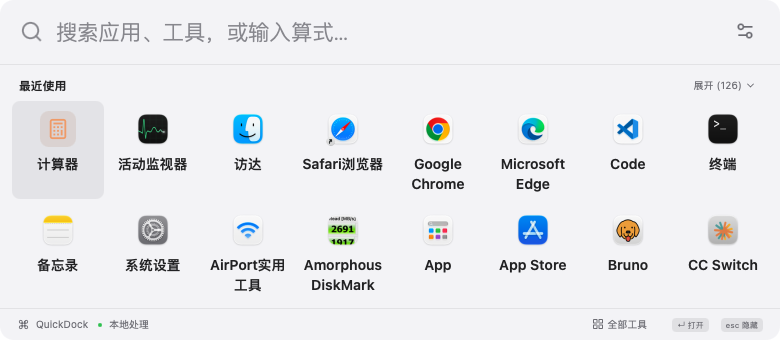

# QuickDock

基于 **Wails 3.1.0 + React + TypeScript** 的跨平台本地快捷工具。默认是紧凑启动面板，设置进入完整页面，工具独占工作区。

支持简体中文、日本語、English、繁體中文、Español，默认跟随系统；可在偏好设置切换，保留工具输入。

## 本地运行

支持 macOS / Windows / Linux 的 arm64 与 x64，安装包由 GitHub Actions 自动编译并发布到 [Releases](https://github.com/yukunwu/QuickDock/releases)。本地打包输出位于 `bin/releases/`。Linux 同时提供 Debian 系 `.deb` 和 Fedora／Red Hat 系 `.rpm`。系统依赖、安装方式及实测范围见 [跨平台验证](docs/CROSS-PLATFORM-VALIDATION.md)。

macOS 将 `QuickDock.app` 拖入“应用程序”后打开，最低 macOS 13。本机安装路径为 `/Applications/QuickDock.app`：

```sh
open /Applications/QuickDock.app
```

- macOS `Option+Space`；Windows／Linux `Ctrl+Alt+Space`：显示／隐藏；设置中选择修饰键，Space 固定。
- Wayland 若无全局快捷键 Portal，在系统键盘设置中把快捷键命令设为 `quickdock --toggle`；重复执行切换原窗口。
- macOS／Windows／Linux X11 唤起跟随鼠标所在屏幕；Wayland 由桌面系统安排窗口位置。
- 空搜索展示最近使用的应用／工具，方向键选择，Enter 执行；支持中文、拼音、首字母和网址别名。
- 输入无应用匹配时，提供 Google 搜索与翻译快捷项；搜索使用默认浏览器，翻译保留在当前 Dock。设置可分别关闭这两个入口。
- 顶部设置按钮或 `⌘ ,` 进入设置；底部“全部工具”进入工具库。
- 工具页占满窗口，不展示应用侧边栏和导航。Esc 回紧凑 Dock，Dock 再按 Esc 隐藏；独立工具 Esc 保存后关闭。`⌘ W` 隐藏，输入在本次会话中保留。
- 启动器失焦隐藏；工具和设置失焦保留。菜单栏闪电图标 可打开、刷新索引或退出。
- 重复启动只唤起原实例。

macOS `.app` 使用 ad-hoc 签名，不含 Developer ID 签名或公证。内置自动更新检查与手动下载安装，发布包校验 SHA256；详情见 [自动更新](docs/UPDATES.md)。无需前端开发服务器即可运行。



## 十一类内置工具

| 工具 | 已实现功能 |
| --- | --- |
| 翻译 | 原生内嵌Google翻译网页；Dock快捷入口／独立窗口、页面输入、原文与语言恢复 |
| 计算稿纸 | 多行四则／括号／百分比，#备注，ans引用上一结果；逐行错误；⌘Enter保存本地历史，可载入／删除／清空；保留搜索内快速计算 |
| 时间戳 | 秒／毫秒、时间戳／日期双向、本地／UTC；无效日期和时区跳跃校验 |
| JSON | 格式化／压缩／错误提示；保留大整数精度 |
| Base64 | 标准 Base64 与 UTF-8 文本双向转换；非法字符、填充位、非 UTF-8 内容校验 |
| URL | URL **组件**编码／解码，`+` 不作为空格处理 |
| UUID | 安全随机 v4，单个／批量 1–1000 个，复制 |
| 文本哈希 | MD5、SHA1、SHA256、SHA512 |
| 单位换算 | 长度、质量、温度、面积、体积、速度、容量；十进制／二进制分别标明 |
| 文本处理 | 大小写、逐行 trim、删空行、去重、自然排序、Unicode 字符／行／UTF-8 字节统计 |
| 常用网址 | 名称、URL、别名增删改；搜索和默认浏览器打开；仅 HTTP(S) |

没有外部插件 SDK、商店或 uTools 兼容层。新增内置工具通过 `frontend/src/catalog.ts` 的 `ToolDefinition` 注册，纯转换逻辑在 `frontend/src/tools/` 中。

## 数据与原生能力

Windows 读取开始菜单／桌面快捷方式和已注册应用，ShellExecute 启动；Linux 读取 XDG／Flatpak／Snap `.desktop` 入口，通过 GIO 启动和 xdg-open 打开网址。Windows 数据位于 `%APPDATA%/QuickDock`；Linux 位于 `$XDG_CONFIG_HOME/QuickDock`（默认 `~/.config/QuickDock`）。以下路径说明为 macOS：

- 扫描 `/Applications`、`~/Applications`、`/System/Applications`，额外索引 Finder；不递归进入 `.app` 的内部 helper。
- 通过 AppKit 读取真实名称、图标和 Bundle ID，通过 NSWorkspace 启动应用、打开网址。
- 冷启动后台建立索引；已有缓存时先展示缓存，再刷新。目录扫描在后台，AppKit 操作切回主线程。
- 配置和使用记录：`~/Library/Application Support/QuickDock/settings.json`。
- 应用缓存：同目录 `apps.json`。JSON 带版本，原子写入；损坏配置保留 `.corrupt-时间戳` 备份并恢复默认，未知未来版本禁止覆盖。
- Dock内普通工具未保存的输入仅保留本次会话；独立窗口输入自动保存到`tool-windows/`；内部内存回收通过当前 WebView 会话历史临时传递草稿。
- 明确保存的计算历史写入同目录 `calculations.json`，版本化原子JSON，最多100份／约8MiB。单稿纸最多200行／20000字符，重启后保留；浏览器预览历史独立保存在localStorage。
- 翻译通过原生WebView直接展示Google翻译网页，网页内输入交给Google处理；不再调用公共翻译API。独立页保存当前原文／语言，Google网页可能要求网站验证。详见[网页翻译验证](docs/GOOGLE-WEB-VALIDATION.md)。
- 浏览器预览明确使用示例应用，不能启动本机应用。原生版本通过 Wails 生成的类型绑定调用 Go。

## 构建与测试

三平台交付在 macOS 执行 `./scripts/build-platforms.sh`，再运行 `go install github.com/goreleaser/nfpm/v2/cmd/nfpm@v2.45.2` 和 `python3 scripts/package-platforms.py`。首次先运行 `./scripts/build-macos.sh` 生成应用图标。Linux 主机构建会生成 Windows／Linux 产物，Linux 包使用 GTK3 + WebKitGTK 4.1。

macOS 构建需要 Xcode Command Line Tools；项目需要 Go 1.26+、Node 22+ 和 pnpm。当前验证机器为 Go 1.27.1、Node 26.10.0、pnpm 10.32.0。

```sh
go install github.com/wailsapp/wails/v3/cmd/wails3@v3.1.0
pnpm --dir frontend install --frozen-lockfile
./scripts/build-macos.sh
```

构建脚本生成 bindings、编译前端／Go、制作图标和 `.app`，并做 ad-hoc 签名与校验。CLI 和 Go 依赖固定为相同 Wails 版本。`Taskfile.yml` 也可通过 `wails3 task build` 使用。

```sh
pnpm --dir frontend dev                 # 浏览器预览，127.0.0.1:3415
pnpm --dir frontend test                # 30 项逻辑测试
pnpm --dir frontend test:e2e            # Chrome 交互及搜索性能
MACOSX_DEPLOYMENT_TARGET=13.0 \
CGO_CFLAGS='-mmacosx-version-min=13.0' \
CGO_LDFLAGS='-mmacosx-version-min=13.0 -Wl,-no_warn_duplicate_libraries' \
go test -race ./...
```

Playwright 使用本机 `/Applications/Google Chrome.app`，可按实际安装位置修改 `frontend/playwright.config.ts`。开发端口默认 3415，已有服务时复用。

解锁桌面后，可用以下原生 smoke 脚本验证鼠标所在屏幕、相同快捷键隐藏及单实例。它会短暂移动鼠标并切换 QuickDock 的可见性，结束恢复鼠标位置；脚本针对默认 Option+Space，锁屏时跳过。

```sh
swift scripts/native-smoke.swift <QuickDock进程PID> "$PWD/bin/QuickDock.app/Contents/MacOS/QuickDock"
```

大文本计算使用可终止后台任务；结果预览最多 65,536 字符，复制保留全文。隐藏释放工具结果，用过大文本后连续隐藏 30 秒回收页面，唤起时恢复输入并重新计算。测量与回收边界见 [资源验证](docs/RESOURCE-VALIDATION.md)。

具体通过项、测量口径和未完成的人工验收见 [验证记录](docs/VALIDATION.md)。


Dock翻译及计算历史的新增验收、截图和网络边界见 [新增功能验证](docs/ONLINE-NOTEBOOK-VALIDATION.md)。

### 独立工具窗口

搜索“翻译”或在工具库打开翻译，可在Google网页内直接输入文字翻译。工具页／Dock翻译的“独立窗口”携带当前内容弹出；工具库的“独立打开”恢复上次独立保存的页面，菜单栏也可直接打开翻译窗口。独立窗口不随Dock隐藏，输入与选项自动保存，关闭前等待保存。正常退出后重启恢复尚未关闭的窗口；显式关闭后可从工具库再打开，内容仍保留。

独立窗口草稿与几何信息位于 `~/Library/Application Support/QuickDock/tool-windows/`，单工具最多8MiB，底部显示保存状态。Dock内临时输入仍是会话状态。具体原生验证与测试方式见 [独立窗口验证](docs/DETACHED-WINDOWS-VALIDATION.md)。

## GitHub 与自动更新

仓库：[yukunwu/QuickDock](https://github.com/yukunwu/QuickDock)。下载见 [Releases](https://github.com/yukunwu/QuickDock/releases)。分支推送自动测试／编译；推送与 `VERSION` 一致的 `v*` 标签，全部测试通过后自动发布十份包与校验和。

设置页新增“应用更新”，启动后及每 6 小时自动检查稳定版；点击下载校验，再保存并重启。macOS／Windows 原生替换应用，Linux 通过系统包管理器及授权安装。完整流程与限制见 [自动更新说明](docs/UPDATES.md)。

macOS 首次安装推荐下载 Release 中的 `.dmg`（Apple Silicon 选 arm64，Intel 选 x64），打开后将 `QuickDock.app` 拖到 Applications。安装完成推出磁盘映像，再从“应用程序”启动。ZIP 保留供便携分发和应用内自动更新；CI 同时生成两种架构的 DMG，总计十份分发包。
